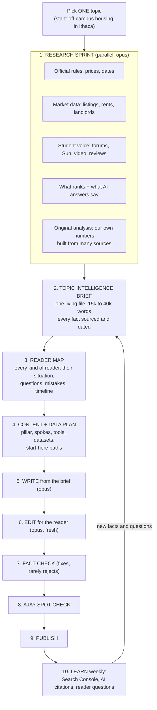

# Footnote Daily v3: topic intelligence first, then readers, then articles

Owner spec, 2026-11-08. Paste into Claude Code in the campus-publication repo together with `footnote-v2-fixes-1.md` and `footnote-style-guide.md`. Keeps everything in v2 (files, lint, render, images, monetization, deploy). Replaces how topics are researched, planned, written and checked. Where it conflicts with `docs/v2/spec.md`, this wins. Save as `docs/v3/spec.md`.

## Why v2 still is not good enough

1. Research is shallow and repeated. Each article does its own few-minute skim of the top 3 results. Nothing builds up; ten articles on housing each re-learn housing badly.
2. Everything comes from public pages. Anything built that way is what ChatGPT can already answer, so nobody has a reason to rank or cite us. The edge has to be depth nobody else assembled plus first-hand information only we have.
3. The fact-checker is the only editor, so writers write defensively and pages read like research memos.
4. One search query = one article, which gives overlapping pages instead of complete coverage.
5. No human and no real data in the loop.

## The v3 idea in one line

Research one topic until we know it better than anyone, write that down as one huge intelligence brief, figure out every kind of reader it affects, and then make every article, table and tool from that brief.

One topic is finished (brief, reader map, plan, all articles and tools published) before the next topic starts. Topic order after housing: getting around and travel, money and costs, dining and food, classes and registration, transfer students, careers and jobs, parents and families, health, daily life in Ithaca, alumni.

## 1. Research sprint (`scripts/v3/research.sh <topic>`)

Five parallel opus sessions, each up to 120 turns, each writing raw notes to `intel/<topic>/raw/<lane>.md`. Every fact carries its source URL, the date it applies to, and the date we checked it. Nothing is summarized away at this stage.

* Lane A, official: every rule, price, deadline, form, office, phone number and policy from the school, city, county, state, transit agencies and utilities. Use `corpus/` plus live pages. Note where official pages contradict each other.
* Lane B, market and data: listings and rent ranges by neighborhood, unit size and distance; landlords and management companies; lease timing; utilities, internet and renters insurance costs; anything countable. Record sample size and date for every number. Read pages the way a person would; no bulk scraping.
* Lane C, student voice: r/Cornell, r/ithaca (via a Reddit API key if Ajay adds one, otherwise search results), College Confidential, the Cornell Daily Sun, YouTube tours and vlogs, public reviews. Capture recurring complaints, tips, horror stories, myths, and how often each comes up. Paraphrase and link; never copy.
* Lane D, the competition: for the 30 most-searched questions in the topic, what the top 5 results and a ChatGPT-style answer say, what they get wrong, and what they leave out.
* Lane E, original analysis: no owner input is needed. This lane creates information nobody else has published by combining public sources: e.g. median rent by neighborhood and unit size from dated listing samples (sample size and dates recorded), total cost of a year by living situation, walking and bus times from each neighborhood to central campus, how deadlines and prices changed year over year (from archived official pages), and patterns counted across student threads ("in 40 r/Cornell lease threads since 2024, the most common complaint was X"). Every calculation is shown step by step in the brief so the fact checker can redo it. Reddit is read through the official API with the owner's OAuth key (PRAW), well under the rate limit; paraphrase and link, never store full posts or usernames.

## 2. Topic intelligence brief (`intel/<topic>/brief.md`)

One synthesis session (opus) merges the five lanes into a single living document. Target 15,000 to 40,000 words. It is the source of truth for the topic; articles cite the original URLs it lists, never the brief itself. Sections:

1. The topic in one page: what everyone needs to know, the five biggest decisions, the five most common mistakes.
2. Fact base: every hard fact grouped by subtopic, in tables, each with source, effective date and checked date.
3. Numbers: every price, cost, rent, distance, time and count, with ranges, sample sizes and how we got them. Includes our own calculations, shown step by step.
4. Timeline: the full year for this topic (what happens when), and how it shifts by start term.
5. Places and players: every relevant building, neighborhood, landlord, office, business and route, with a short profile of each.
6. How it actually works: each process step by step, including the unofficial parts students learn the hard way.
7. Student voice: recurring experiences and tips, with how often each comes up and links.
8. Contradictions and unknowns: where sources disagree, which to trust and why; what nobody knows yet and the closest reliable proxy.
9. What the competition and AI answers miss: the gaps we will fill.
10. Original analysis: the numbers and patterns we computed ourselves, with method, sample size and date.
11. Change log: what changed and when, so articles can be refreshed.

The brief is refreshed whenever the weekly learn step or a fact check finds something new, and fully re-verified each semester.

## 3. Reader map (`intel/<topic>/readers.md`)

From the brief, one session lists every kind of reader the topic affects differently. For housing that likely includes: first-year, sophomore, junior/senior moving off campus, transfer (by class year and start term), international, grad student, student with a family, low budget, no car, needs accommodations, athlete, student working in Ithaca for the summer, parent, landlord-curious alum. For each reader:

* their situation and constraints
* the questions they actually ask, in their words (from demand data and Lane C)
* the decisions they face and the right answer for them, with numbers
* their personal timeline
* their most likely mistakes and what each costs
* which facts in the brief matter most to them

## 4. Content and data plan (`intel/<topic>/plan.md`, rows added to `queue/queue.csv`)

From the brief and reader map, plan everything for the topic at once:

* 1 pillar guide covering the whole topic, 2,500 to 5,000 words, with a table of contents.
* Spoke guides, typically 10 to 30: each a specific question, decision, process, comparison, place or scenario. No two spokes answer the same question. Each lists which reader types it serves.
* Reader guides: for each reader type that changes the answer a lot, a "[Topic] for [reader]" guide (e.g. "Off-campus housing for transfer students").
* Tools: calculators, quizzes and checklists built from the brief's numbers (housing: rent + commute calculator, "when should I sign a lease" timeline, move-in checklist by situation).
* Datasets: original tables we can publish and keep updated (e.g. "Ithaca rent by neighborhood, fall 2026, from N listings"; "Cost of a year at Cornell by living situation, 2026-27", from our own calculations). These are what other sites and AI answers will cite.
* Start-here paths: additions to `/start/<reader>/` pages linking the right guides in the right order.

Ajay approves the plan (one read, about 10 minutes). Then everything in it is queued.

## 5. Write (`scripts/v3/write.sh`)

Opus. Inputs: the brief, the reader map, the plan row, `docs/v2/style.md`, `docs/v2/exemplar.md`, and the list of existing articles for links. No new web research unless the brief marks a hole; if it does, the writer adds the new fact to the brief too. Every article follows three layers:

1. The answer: 3 sentences or fewer, true for most readers.
2. Your situation: "If you're a transfer junior...", "If you don't have a car...", one short block per reader type that changes the answer, with their specific numbers, dates, steps and mistakes.
3. More info: full tables, every rule and edge case, worked examples (clearly labeled example readers walked through with real sourced numbers, never presented as real people), then links down to spokes and up to the pillar.

Plus: at least one table, figure or tool; common mistakes; a short FAQ; photos from the image pipeline.

## 6. Edit (`scripts/v3/edit.sh`)

A fresh opus session, a sharp magazine editor, edits in place for the reader only, running the seven editing passes in Part 6 of `docs/v2/style.md` (structure, cut 20 to 30 percent, line, slop sweep, specificity, read-aloud, visual). It does not change facts or links. It writes a short `content/edits/<slug>.md` log: what it cut, what it moved, which slop it removed. Every 10th article, a second fresh edit session reviews the edited page cold against the AI-slop blacklist and the swap test; anything it flags goes back to the editor once.

## 7. Fact check (`scripts/v3/check.sh`)

Sonnet. Opens every source, checks every hard fact against it and against the brief. Fixes a wrong number, date or attribution in place and logs it (and updates the brief if the brief was wrong). Rejects only if the core answer is wrong or a fact cannot be sourced after one search.

## Publish requirements (checked by `lint.py` before anything goes live)

A page does not publish unless all of these are present. Missing pieces go back to the writer or the image step, not to a reject.

* Pictures: a lead photo under the title, plus at least one more visual (photo, chart, figure, map or tool) for every 600 words. Every photo licensed and credited, with alt text and a caption that adds information. If the image finder finds nothing for the exact subject, it searches for the neighborhood, building, street or a related scene before giving up; only then may the page use charts and figures alone.
* Layers: an "At a glance" box; an answer of 3 sentences or fewer; at least 2 "If you're..." reader blocks (pillars and reader guides: at least 4); then the detailed sections.
* Detail: spokes at least 1,200 words, pillars at least 3,000, reader guides at least 1,500; at least one table; at least 8 cited sources for spokes and 20 for pillars; a common-mistakes section; an FAQ with at least 4 questions; links to the pillar and at least 2 sibling guides.
* Writing: passes the style guide's banned word list; average sentence under 18 words; no research-narration phrases.

Length is a floor, not a target: the editor still cuts filler, and the research brief supplies enough real detail to meet the floor without padding. If a spoke truly cannot reach 1,200 useful words, it is merged into a bigger guide instead of padded.
Re-run every currently published v2 article through steps 5 to 7 so it meets these requirements too.

## 8. Ajay spot check

`reports/to-read.md` lists new pages with one-line summaries. Ajay reads all of the first topic, then 1 in 5. 👍 or a one-line note. Notes become style guide, exemplar or brief edits, never code rules.

## 9. Publish and 10. Learn

Publish as in v2. Launch on the real domain once the first topic is complete. Weekly: Search Console queries and positions, the AI citation check, and reader questions (contact form) go into `reports/weekly.md` and back into the brief and queue: rewrites, new spokes, new reader types.

## The quality ratchet (how it gets better every week)

Four loops, all feeding the same three files (`docs/v2/style.md`, `docs/v2/exemplar.md` plus `docs/v3/best/`, and the topic briefs). No new gates or scores.

1. Best-of-two drafts. For pillars and reader guides, write two drafts with different approaches (e.g. one organized by decision, one by timeline). A fresh opus session reads both cold as the target reader and picks the more useful one, then merges in anything the loser did better. Spokes get one draft.
2. Reader test. Before publish, a fresh session plays 3 real readers from the reader map (e.g. a nervous international first-year, a transfer junior on a budget, a parent paying the bill). Each reads the page and lists: questions it still has, anything confusing, anything that felt like filler. The writer fixes these once.
3. Best-pages library. Every page Ajay marks 👍, and every page that wins the blind compare, is copied to `docs/v3/best/` with a two-line note on why it is good. Writers and editors read the 3 most similar best pages before working. Pages Ajay marks with a note go to `docs/v3/worst/` with what was wrong. The library grows; the bar rises.
4. Weekly lessons. Every Monday one session reads the week's edit logs, fact-check fixes, reader-test findings, Ajay's notes and Search Console data, and proposes at most 5 changes to the style guide, exemplar or briefs, with the evidence for each. Ajay approves or rejects them in `reports/lessons.md`; approved changes are applied. Also: rewrite the 5 weakest live pages (low clicks for their impressions, or position 8 to 20).

Real-reader signals feed the same loops once the site is live: a one-tap "Did this answer your question? Yes / No, I still need..." box at the bottom of every page (answers stored by the form provider, no personal data).

## Tools (plain JavaScript in the page, no accounts, nothing stored or sent)

Built per topic from the brief's numbers, showing the date the numbers are from. First set: meal plan calculator, rent + commute calculator, "do I need a car" quiz, housing timeline by start term, move-in checklist by situation. Each tool gets its own page and is embedded in the articles it serves.

## Speed mode (default; owner decision 2026-11-08: v3 as first written is too slow)

Same quality bar, far less repeated work:

1. Verify facts once, in the brief. The brief's facts are checked when the brief is built (one sonnet pass per lane). Articles then use brief facts freely; the per-article fact check only checks facts that are NOT in the brief, plus our own math. Most articles have few or none.
2. One session writes and edits. A single opus session writes the draft, then runs the seven editing passes on its own draft, then the 3-reader test, then saves. No separate edit and reader-test sessions. Every 10th article still gets a fresh cold editor read to catch drift.
3. Code does the rest: images (finder, download, credits), lint, render and deploy are scripts, not sessions.
4. Research several topics at once, ahead of time. Run briefs for 3 to 4 topics in parallel (housing, getting around, money, dining) so writing never waits. Brief building is best started overnight; writing runs during the day.
5. Start writing before the brief is perfect. As soon as the official and market lanes finish, spokes that only need those facts start; the rest wait for the student-voice lane.
6. Workers: 8 (configurable). The cap is the subscription's usage limit, not the clock; the existing pause and auto-resume handle it.
7. Model split: opus for write+edit; sonnet for research lanes, brief fact checks and the small per-article check. Best-of-two drafts only for pillars.
8. Report real speed every 10 articles: articles per hour, session-minutes per article, and time paused on usage limits, so the owner can see where time goes.

Expected: roughly 15 to 20 minutes of session time per spoke, so with 8 workers about 15 to 25 finished articles per 30 minutes of wall time while under the usage limit. Measure in the first hour and report.

## Pace

See Speed mode above. The usage-limit pause and STOP file work as before.

## Acceptance (first topic: off-campus housing in Ithaca)

1. `intel/off-campus-housing/brief.md` exists, at least 15,000 words, every hard fact sourced and dated; Ajay reads the one-page summary and the contradictions section.
2. Reader map with at least 10 reader types; plan approved by Ajay.
3. Pillar, at least 12 spokes, at least 3 reader guides, the rent + commute calculator, and one original dataset published.
4. Ajay's blind compare: 5 spokes against the #1 Google result and a fresh ChatGPT answer to the same question; ours preferred on at least 4.
5. Average sentence length under 18 words; zero research-narration phrases.

## Guardrails

Same as v2: no new gates, scores or databases; quality fixes go in prompts, the style guide, the exemplar and the brief. Never invent facts, numbers, quotes or people. No owner field notes, surveys or interviews are part of this pipeline. Respect robots and site terms; no logins; no bulk scraping.
